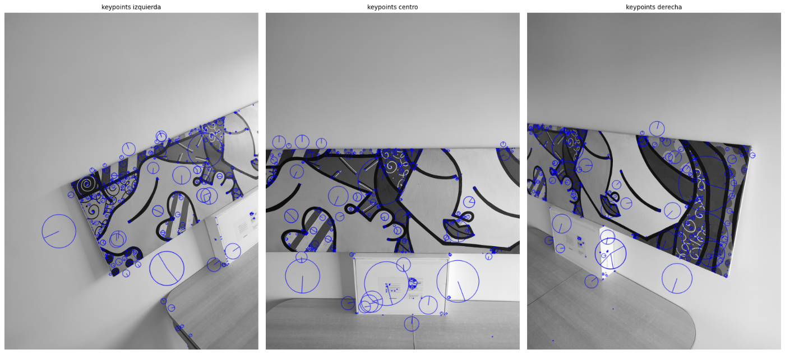
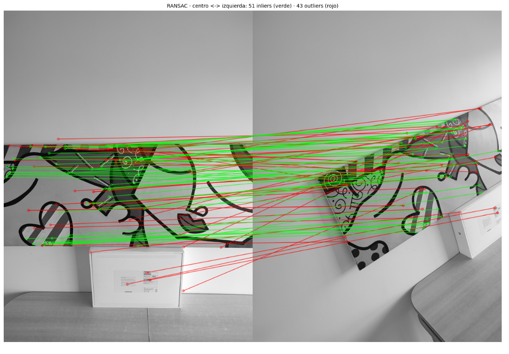
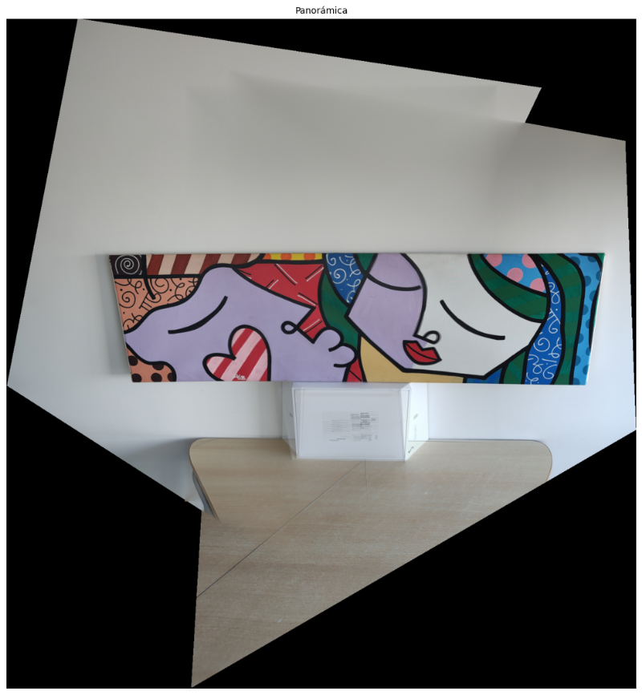
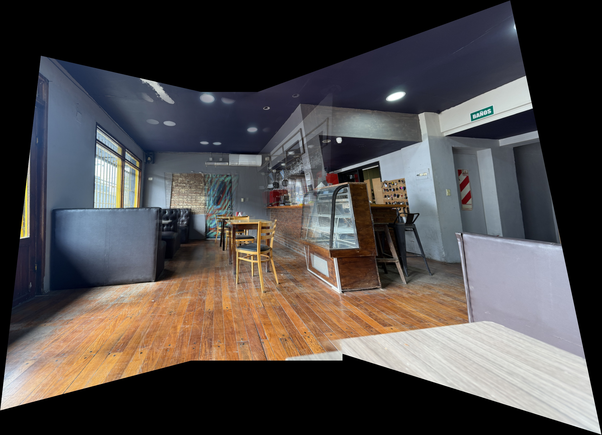

# Panorama Stitching
### Unión de fotografías con homografías

Tres fotos superpuestas de una misma escena, una sola panorámica. El trabajo recorre todo el proceso: encontrar puntos en común entre las imágenes, calcular cómo se relaciona cada vista con la central y mezclarlas sin que se noten las uniones.

**García, González y Turkie** · Visión Artificial, UdeSA · septiembre de 2026

[Informe](docs/informe.pdf) · [Notebook liviano](tp1_pano_sin_salidas.ipynb) · [Código](panorama.py)

## Recorrido

### 1. Detectar puntos característicos

Usamos SIFT para encontrar puntos reconocibles en cada imagen. Como tienden a amontonarse en las zonas con más textura, implementamos A-NMS (supresión adaptativa de no máximos) para quedarnos con puntos fuertes y bien repartidos.

### 2. Emparejar y descartar coincidencias falsas

Emparejamos los descriptores con fuerza bruta, cross-check y el test de Lowe. Aun así quedan coincidencias erróneas, así que estimamos la homografía con RANSAC, implementado con NumPy junto con DLT: en verde, las coincidencias que la homografía explica; en rojo, las descartadas.

### 3. Proyectar y mezclar

Con la imagen central como ancla, proyectamos las laterales sobre un lienzo común y las mezclamos con un blending ponderado para suavizar las uniones.

## Resultados

Probamos tres escenas: un cuadro, el campus de UdeSA y fotos propias.

| Conjunto | Tamaño de la panorámica | Inliers izq./der. | RMSE izq./der. |
| --- | --- | --- | --- |
| Cuadro | 1542 × 1651 | 47 / 22 | 1,461 / 1,819 px |
| UdeSA | 1394 × 825 | 97 / 30 | 0,731 / 0,849 px |
| Fotos propias | 3197 × 2309 | 38 / 14 | 0,726 / 0,582 px |

El RMSE mide el error de reproyección sobre los inliers, en imágenes reducidas.

## Probarlo

Desde la raíz, con uv instalado:

~~~sh
uv venv --python 3.11.18 --seed
uv pip install -r requirements.txt
uv run --no-project python scripts/generar_ejemplos.py --dataset all
~~~

El script genera las panorámicas y sus métricas en **resultados/**. Para seguir el desarrollo paso a paso, abrir el notebook con JupyterLab. El [notebook original](tp1_pano.ipynb) conserva las salidas (unos 34 MB). Las imágenes del cuadro y del campus son material de la cátedra.

[Parámetros, entorno y documentación de la entrega](DOCUMENTACION.md)
