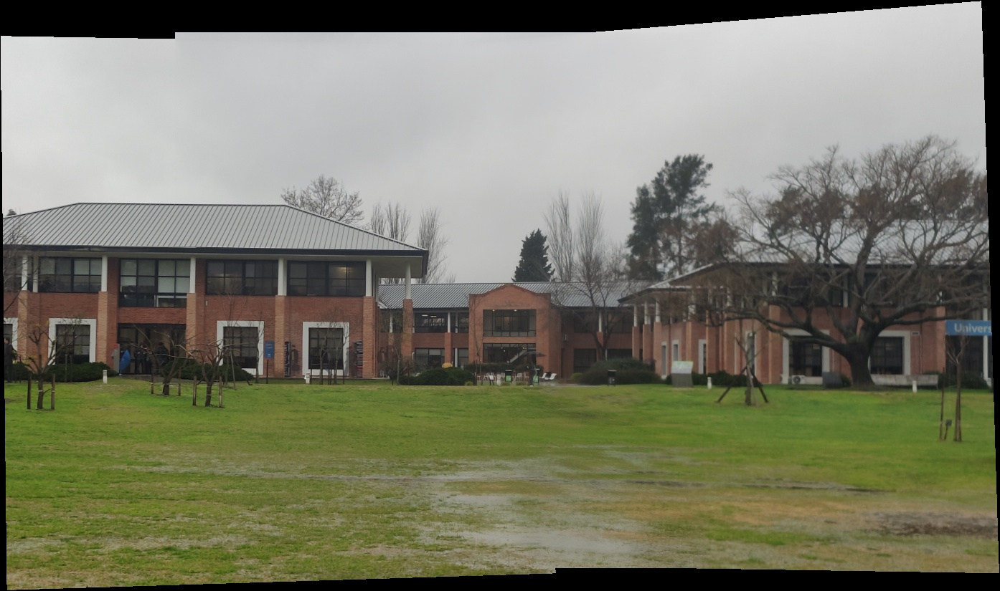

# Panorama Stitching
### Unión de fotografías con homografías

Tres fotos superpuestas se convierten en una panorámica mediante detección de puntos, búsqueda de correspondencias, estimación robusta de homografías y mezcla de imágenes.

**García, González y Turkie** · Visión Artificial, UdeSA · septiembre de 2026.

[Informe](docs/informe.pdf) · [Notebook liviano](tp1_pano_sin_salidas.ipynb) · [Código](panorama.py)

## Implementación

Usamos SIFT y matching de OpenCV. Implementamos con NumPy la selección A-NMS, DLT, RANSAC, el cálculo del lienzo y el blending ponderado. La imagen central funciona como ancla para proyectar las dos vistas laterales.

El repositorio incluye tres conjuntos: un cuadro, el campus de UdeSA y fotografías propias.

| Conjunto | Tamaño de la panorámica | Inliers izq./der. | RMSE izq./der. |
| --- | --- | --- | --- |
| Cuadro | 1542 × 1651 | 47 / 22 | 1,461 / 1,819 px |
| UdeSA | 1394 × 825 | 97 / 30 | 0,731 / 0,849 px |
| Fotos propias | 3197 × 2309 | 38 / 14 | 0,726 / 0,582 px |

El RMSE mide reproyección sobre inliers en imágenes reducidas; no compara el resultado con una panorámica de referencia.

## Probar con los datos incluidos

Desde la raíz, con uv instalado:

~~~sh
uv venv --python 3.11.18 --seed
uv pip install -r requirements.txt
uv run --no-project python scripts/generar_ejemplos.py --dataset all
~~~

El script genera las panorámicas y métricas en **resultados/**. Para seguir el desarrollo paso a paso, abrir el notebook con JupyterLab desde la raíz.

El [notebook original](tp1_pano.ipynb) conserva sus salidas y pesa unos 34 MB; la copia liviana tiene las mismas celdas. Las imágenes de cuadro y campus son material de la cátedra.

[Parámetros, entorno y documentación de la entrega](DOCUMENTACION.md).
